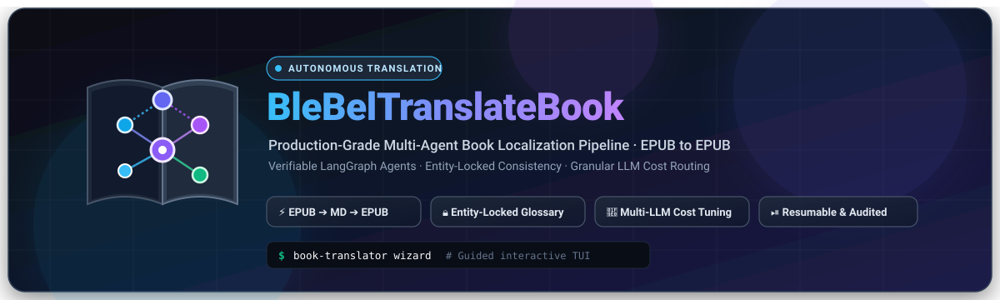
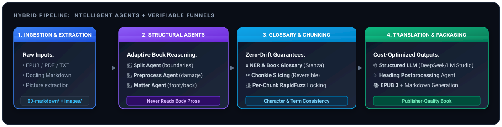
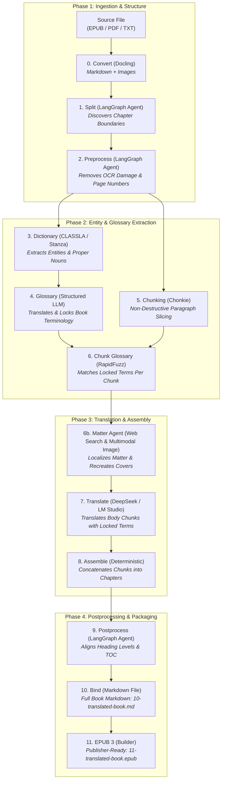

<div align="center">



<br/>

[](https://www.python.org/downloads/)
[](LICENSE)
[](https://github.com/langchain-ai/langgraph)
[](https://lmstudio.ai/)
[](tests/)
[](#hybrid-pipeline-overview)

**Turn full-length books into publisher-grade, consistent translations through staged, verifiable AI agents and deterministic funnels.**

[Quickstart](#quickstart) •
[Why Agents?](#the-messy-reality-of-books-why-agents-win) •
[Interactive Wizard](#interactive-cli-wizard) •
[Model Cost Routing](#multi-llm-configuration--cost-optimization) •
[Documentation Portal](docs/README.md) •
[License](#open-source-license)

<br/>



</div>

---

## The Messy Reality of Books: Why Agents Win

Translating an entire 80,000+ word book is one of the hardest NLP challenges in the wild:

* **Raw books are structurally messy:** EPUB conversions and OCR extracts are plagued by page numbers interleaved mid-sentence, running headers disguised as headings, split paragraphs, footnotes, unpredictable typography, roman numerals, and broken formatting.
* **Why pure deterministic code fails:** Hand-crafted regular expressions and fixed string scripts are brittle. A regex rule tuned for Chapter 1 will inevitably mangle Chapter 4 because author styling, scene breaks, and chapter markers evolve throughout a volume. Fixed byte or character chunking ruthlessly slices dialogue and sentences in half.
* **Why monolithic LLMs fail:** Throwing full manuscripts (or huge multi-thousand-word blocks) into a single LLM context causes **catastrophic drift**: character names mutate mid-story, locations are translated inconsistently, paragraphs are silently omitted, hallucinated text appears, and token costs explode.

### The BleBel Hybrid Architecture

**BleBelTranslateBook** solves this dilemma by coupling **fuzzy agentic intelligence** with **deterministic byte-for-byte funnels**:

1. **Specialized LangGraph Agents for Messy Structural Reasoning:**  
   Four autonomous agents tackle the fuzzy, unpredictable tasks—discovering true chapter boundaries (`Split Agent`), scrubbing OCR headers and page damage (`Preprocess Agent`), researching and adapting front/back matter (`Matter Agent`), and harmonizing titles and TOC alignment (`Postprocess Agent`)—**all without ever reading the sensitive body prose**.
2. **Deterministic Funnels for Zero-Drift Guarantees:**  
   Exact slicing, Named Entity Recognition (NER), fuzzy dictionary retrieval, chunk assembly, and EPUB packaging run through verifiable, deterministic Python code with **zero LLM intervention**.
3. **Entity-Locked Translation:**  
   A unified book glossary is compiled in reading order. Before translating each paragraph chunk, exact and fuzzy entity matchers lock character names, family titles, and specialized terms, preventing identity and terminology drift across all chapters.

---

## Key Highlights & Features

| Capability | What It Does | Why It Matters |
| :--- | :--- | :--- |
| ⚡ **Full Markdown Lifecycle** | Input: `EPUB`, `PDF`, `TXT`, or `MD`. Processing: `Markdown`. Output: `Markdown` + `EPUB 3`. | Clean, transparent, human-readable intermediate text at every single stage. You can inspect or edit any chapter with standard text tools. |
| 🔒 **Entity-Locked Glossary** | NLP NER (`CLASSLA` / `Stanza`) extracts entities; structured LLM assigns translations; `rapidfuzz` matches them per chunk. | Character names, places, and terminology stay 100% consistent from page 1 to the final epilogue. |
| 🧠 **Granular LLM Cost Routing** | Assign different models and providers to individual stages in `book_translator.toml`. | Route cheap/fast models (e.g. DeepSeek Flash, Gemini Flash) to structural tasks, and frontier models or local offline LLMs (LM Studio) to translation. |
| ⏯️ **Pause, Resume & Chapter Subsets** | Durable manifests track every step. Run `--skip-if-present`, or test with `--first-chapters 3`. | Never lose progress when an API times out. Preview translation tone on 3 chapters before spending budget on an 80-chapter volume. |
| 📊 **Real-Time Token & Cost Auditing** | Live console meters track prompt tokens, completion tokens, LLM calls, and per-chapter timings. | Full transparency into API spending. Run `--dry-run` to inspect token budgets without spending a cent. |
| 🧙 **Interactive CLI Wizard** | Beautiful terminal UI (`book-translator wizard`) with guided presets and book auto-detection. | Translating a book requires zero memorization of CLI arguments. Just run the wizard and pick your options. |
| 🖼️ **Illustration Preservation** | Docling extracts illustrations and vector media into `images/`, preserving placement. | Your output EPUB retains original book illustrations, cover art, and inline drawings. |

---

## Pipeline Architecture

The pipeline decomposes book translation into **12 verifiable stages**:



### Stage Reference Matrix

| Stage | Name | Engine / Tool | Purpose & Guarantees | Output Path |
| :---: | :--- | :--- | :--- | :--- |
| **0** | **Convert** | `docling` | Converts EPUB/PDF/TXT to clean Markdown and extracts book illustrations. | `00-markdown/` + `images/` |
| **1** | **Split** | LangGraph Agent | Discovers chapter beginnings without reading prose; performs byte-exact cuts. | `01-chapters/` |
| **2** | **Preprocess** | LangGraph Agent | Eliminates running headers, orphan page numbers, and OCR scanning noise. | `02-preprocessed/` |
| **3** | **Dictionary** | CLASSLA / Stanza | Funnels sentences and identifies named entities (PER, LOC, ORG). | `03-reduced/` & `unique/` |
| **4** | **Glossary** | Structured LLM | Builds an accumulative, book-wide bilingual glossary in reading order. | `04-glossary/` |
| **5** | **Chunk** | `chonkie` | Recursively cuts chapters into ~1,000-token chunks at natural paragraph boundaries. | `05-chunks/` |
| **6** | **Chunk Glossary** | `rapidfuzz` | Filters and attaches *only* the glossary terms relevant to each chunk (zero LLM waste). | `06-chunk-glossary/` |
| **6b**| **Matter** | LangGraph Agent + Multimodal Model | Localizes title, foreword, bio, credits BleBel, prunes imprint, and recreates cover/plates multimodally (multimodal model required). | `06b-matter/` + `07-translations/` |
| **7** | **Translate** | DeepSeek / LM Studio | Translates chunks with strict JSON schema, entity locking, and prompt auditing. | `07-translations/` |
| **8** | **Assemble** | Deterministic | Reassembles translated chunks back into complete, formatted chapters. | `08-translated-chapters/` |
| **9** | **Postprocess** | LangGraph Agent | Verifies chapter titles, TOC headings, and opening paragraph formatting. | `09-postprocessed-chapters/` |
| **10**| **Bind** | Deterministic | Concatenates all localized chapters into a single unified Markdown file. | `10-translated-book.md` |
| **11**| **EPUB** | `markdown-it-py` | Compiles a valid EPUB 3 volume with NCX/nav TOC, styling, and embedded artwork. | `11-translated-book.epub` |

---

## Quickstart

### 1. Requirements & Installation

BleBel requires **Python 3.11+**.

```bash
# Clone the repository
git clone https://github.com/your-org/BleBelTranslateBook.git
cd BleBelTranslateBook

# Create and activate a virtual environment
python3 -m venv .venv_splitter
source .venv_splitter/bin/activate

# Install dependencies
pip install -r requirements.txt
```

### 2. Configure Credentials

Create a `.env` file in the project root:

```bash
# Cloud Providers:
DEEPSEEK_API_KEY=sk-your-deepseek-key      # Default: high speed, low cost
OPENAI_API_KEY=sk-your-openai-key          # Optional: GPT-4o, o3-mini
GEMINI_API_KEY=AIzaSy-your-gemini-key      # Optional: Gemini 2.5 Flash / Pro
ANTHROPIC_API_KEY=sk-ant-your-claude-key   # Optional: Claude 3.7 Sonnet

# Local / Offline Execution:
# No API keys required! Just launch LM Studio on http://127.0.0.1:1234
```

---

## Interactive CLI Wizard

The easiest way to translate or prepare a book is via the **interactive terminal wizard**. It automatically scans `data/input/` for books, presents workflow presets, lets you choose providers, and configures chapter subsets:

```bash
book-translator wizard
# or: python scripts/run_wizard.py
```

```text
┌────────────────────────────────────────────────────────┐
│           BleBel Book Translation Pipeline             │
│      Interactive Step-by-Step Configuration Wizard     │
└────────────────────────────────────────────────────────┘

Available Books in data/input/:
  [1] Alice-in-Wonderland.epub (2.4 MB)
  [2] Dont-You-Forget-About-Me.pdf (1.8 MB)

Select Workflow Preset:
  [1] Full Pipeline (Stages 0-11: Convert ➔ Split ➔ Translate ➔ EPUB)
  [2] Preview / Test Run (Translate only first N chapters to verify quality)
  [3] Preparation & Glossary Only (Stages 0-6: Zero LLM translation cost)
  [4] Translate & Assemble Existing Chunks (Resume existing prepared chunks)
  [5] Convert Only (Stage 0: Extract Markdown & illustrations)
  [6] Custom Window (--start-at, --stop-after)
```

---

## Command-Line Usage

Prefer running via CLI commands or headless scripts? The pipeline offers full granular control:

### 1. Zero-Cost Structure & Glossary Preparation
Run stages 0 through 6 to convert the book, clean chapter headers, extract characters into the glossary, and chunk the text without spending any translation tokens:

```bash
book-translator-pipeline "MyBook.epub" --cpu
```

### 2. Preview First Few Chapters
Translate only the first 3 chapters to preview tone, formatting, and translation quality before running the entire volume:

```bash
book-translator-pipeline "MyBook.epub" \
  --first-chapters 3 \
  --with-translate \
  --with-postprocess \
  --cpu
```

### 3. Translate 100% Offline with Local LM Studio
Translate without sending data to the cloud or incurring API costs using [LM Studio](https://lmstudio.ai/). The pipeline auto-detects whichever model is currently loaded:

```bash
book-translator-pipeline "MyBook.epub" \
  --with-translate \
  --translate-provider lmstudio \
  --skip-if-present \
  --cpu
```

### 4. Resume an Interrupted Run
If a network hiccup or rate limit occurs, re-run with `--skip-if-present`. The pipeline skips all completed chapters and chunks, picking up right where it stopped:

```bash
book-translator-pipeline "MyBook.epub" \
  --with-translate \
  --skip-if-present \
  --cpu
```

### 5. Validate Without Spending Tokens (`--dry-run`)
Inspect token budgets, file mappings, and agent execution plans without calling paid models or writing files:

```bash
book-translator-pipeline "MyBook.epub" --dry-run
```

---

## Multi-LLM Configuration & Cost Optimization

Books are long, and calling frontier models for simple tasks is needlessly expensive. BleBel allows you to **mix and match models per stage** in `book_translator.toml`:

```toml
# book_translator.toml

# Global default: Fast and affordable DeepSeek Flash
[llm]
provider = "deepseek"
model = "deepseek-flash"
temperature = 0.0

# Stage 1 (Split Agent): Use ultra-fast Gemini Flash to locate chapters
[llm.split]
provider = "gemini"
model = "gemini-2.5-flash"

# Stage 2 (Preprocess Agent): Scrub OCR artifacts with DeepSeek Flash
[llm.preprocess]
model = "deepseek-flash"

# Stage 4 (Glossary Agent): Lock terminology with Claude 3.5 Haiku
[llm.dictionary]
provider = "claude"
model = "anthropic/claude-3.5-haiku"

# Stage 7 (Body Translation): Use local, free, offline LM Studio
[llm.translate]
provider = "lmstudio"
# No model string needed — auto-detects model loaded in LM Studio!
```

You can also override any stage directly from the command line:
```bash
book-translator-pipeline "Book.epub" \
  --llm split.model=deepseek-flash \
  --llm translate.provider=lmstudio
```

---

## Real-Time Token & Progress Monitoring

During translation, BleBel provides live, streaming visibility into token consumption:

```text
  [Stage 7] Body Translation (LM Studio · Qwen2.5-14B)
    ✓ Chapter 01 (3 chunks) ·    4,120 tok ·  18.2s
    ✓ Chapter 02 (4 chunks) ·    5,830 tok ·  24.1s
    ✓ Chapter 03 (3 chunks) ·    3,940 tok ·  17.0s
    ─────────────────────────────────────────────
    Tokens: 13,890 total (9,240 in, 4,650 out) over 3 chapter(s), 10 call(s)
```

Need to audit prompt tokens across preprocessing? Run:
```bash
python scripts/audit_preprocess_tokens.py
```

---

## Systematic Documentation Suite

For in-depth architectural guides, schemas, and API references, explore the [`docs/`](docs/README.md) directory:

* 📖 **[Documentation Portal](docs/README.md)**: Master index and role-based reading guides.
* 🏛️ **[System Architecture](docs/architecture/overview.md)**: Core design invariants, plan-action separation, and reversibility.
* 🤖 **[LangGraph Agents Deep Dive](docs/architecture/langgraph-agents.md)**: State machines, tools, and fallback policies for all 4 agents.
* 📦 **[Pipeline Stages 0 to 5](docs/pipeline/stages-0-to-5.md)**: Ingestion, chapter splitting, cleaning, dictionary funnel, and chunking.
* 🚀 **[Pipeline Stages 6 to 11](docs/pipeline/stages-6-to-11.md)**: Glossary locking, front/back matter, translation, assembly, and EPUB 3 packaging.
* ⚙️ **[Models & Providers Configuration](docs/configuration/models-and-providers.md)**: Detailed provider setups, LM Studio, Ollama, API keys, and TOML reference.
* 💻 **[CLI Reference](docs/cli/reference.md)**: Full manual for all 18 CLI subcommands, flags, and helper scripts.
* 📁 **[Data Layout & Contracts](docs/data-layout-and-contracts.md)**: Directory conventions, manifest JSON schemas, traces, and prompt audit files.
* 🧪 **[Development & Testing](docs/development/contributing-and-testing.md)**: Setup, 800+ offline pytest suite, snapshot testing, Ruff, and Mypy.

---

## Testing & Verification

BleBel comes with an extensive, **100% offline test suite** of over 800 test cases:

```bash
# Run the complete offline test suite
pytest

# Run linter and type checker
ruff check .
mypy
```

---

## Open Source License

This project is open-source software licensed under the **[MIT License](LICENSE)**—one of the most permissive and developer-friendly open-source licenses available. 

You are free to use, modify, distribute, copy, merge, publish, and integrate this software into private or commercial projects without restrictive copyleft requirements.

---

<div align="center">
Made with care for book lovers, authors, and translation engineers everywhere.
</div>
