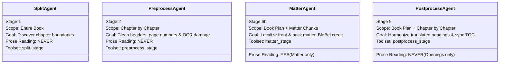
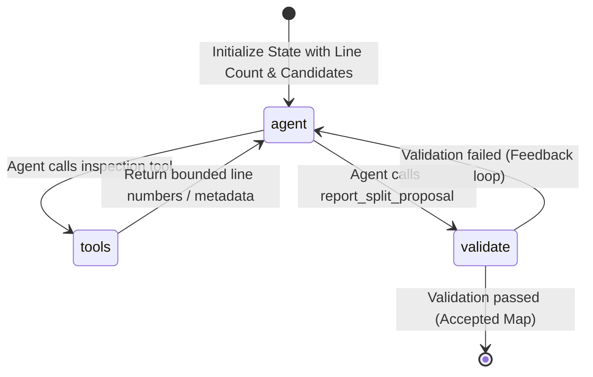
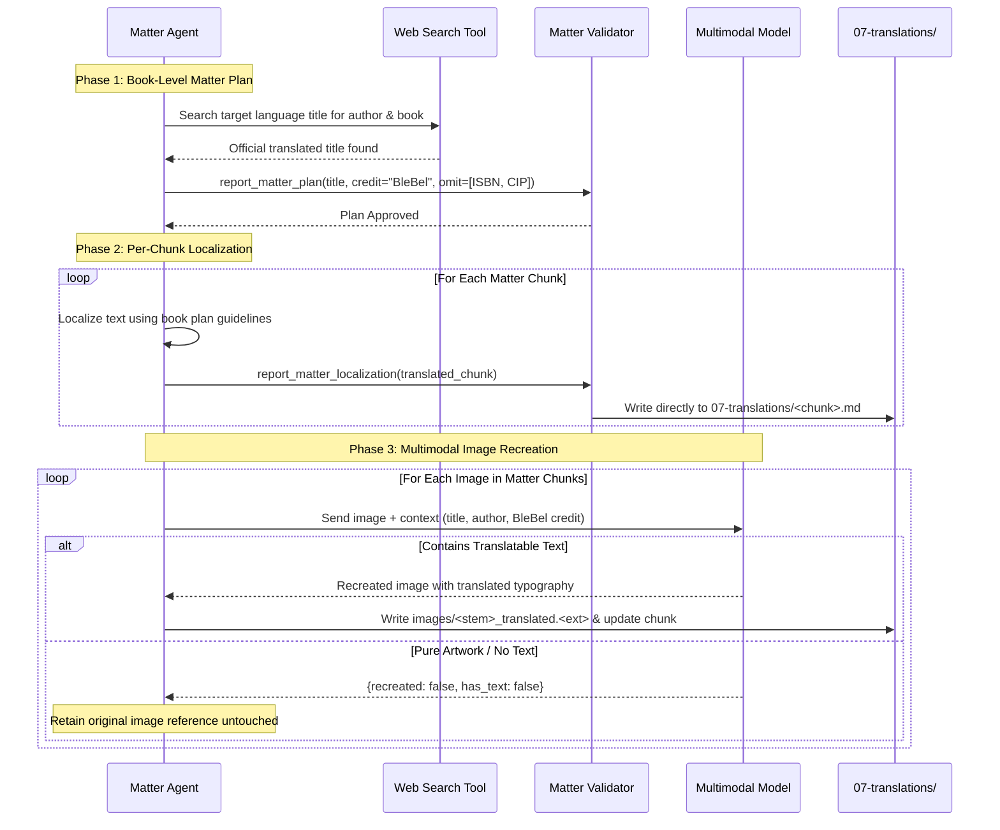

# The 4 LangGraph Agents: Design & State Machines

`book-translator` deploys four specialized LangGraph state machine agents. Each agent addresses a specific structural challenge that requires semantic judgment rather than purely algorithmic rules, while strictly obeying the architectural guardrail: **agents never read body prose unless specifically tasked with matter translation**.

---

## Agent Overview

---

## 1. Split Agent (Stage 1: Chapter Boundaries)

* **Source Module:** [book_translator/stages/agent/](file:///home/jovis/Documents/WORK/BleBelTranslateBook/book_translator/stages/agent/)
* **Input:** `00-markdown/<book>.md` (or raw source Markdown)
* **Output:** Slicing map -> `01-chapters/` (Verbatim chapter files + `_split_manifest.json`)
* **Core Contract:** The agent never sees book paragraphs; it receives only line numbers and candidate headings emitted by deterministic extractors.

### State Machine Architecture

### State Definition (`SplitterState`)
* `messages`: Conversation history between LLM and tools.
* `source_lines`: Total line count of the source document.
* `proposal`: Proposed split points `{line_number, title, kind}`.
* `issues`: Validation errors returned if proposed points are invalid.
* `attempts`: Counter tracking feedback loops (capped by `MAX_FEEDBACK_LOOPS = 4`).

### Toolset (`split_stage`)
* `extract_markdown_headers`: Finds lines beginning with `#`, `##`, etc.
* `search_patterns`: Regex search for chapter-like patterns (e.g. `^Chapter \d+`, `^[IVXLCDM]+$`, `^GLAVA \d+`).
* `scan_table_of_contents`: Locates and parses the printed table of contents in the front matter.
* `inspect_front_matter`: Retrieves the first N lines (capped at 20,000 characters) to identify prefaces, title pages, and copyright blocks.
* `inspect_line_window`: Inspects a narrow window around a target line to verify candidate headings without reading adjacent prose.
* `report_split_proposal`: Terminal tool where the agent submits its proposed split map.

### Deterministic Validation Contract
Before any file is written, [book_translator/stages/slicing/validation.py](file:///home/jovis/Documents/WORK/BleBelTranslateBook/book_translator/stages/slicing/validation.py) verifies:
1. Split line numbers are strictly monotonically increasing.
2. The first chapter begins at line 0 or after verified front matter.
3. No splits create empty chapters or abnormally small fragments (< 2 lines).
4. No excessive gaps exist that suggest missed chapters (> 400 lines without a split unless verified).

---

## 2. Preprocess Agent (Stage 2: Header & Damage Repair)

* **Source Module:** [book_translator/stages/preprocess_agent/](file:///home/jovis/Documents/WORK/BleBelTranslateBook/book_translator/stages/preprocess_agent/)
* **Input:** Chapter files from `01-chapters/`
* **Output:** Cleaned chapters in `02-preprocessed/` + `_preprocess_manifest.json`
* **Core Contract:** Operates sequentially chapter-by-chapter. The agent inspects headers, stray numbers, and damaged lines, outputting an action plan in a closed vocabulary.

### Execution Loop
Each chapter is processed independently:
1. Deterministic damage scan detects:
   * Isolated page numbers printed in the header/footer.
   * Split headings caused by PDF page boundaries.
   * All-caps lines that belong as Markdown subheadings.
   * Soft hyphenation and split words.
2. The agent is invoked with damage records and header excerpts.
3. The agent calls `report_chapter_cleaning` with discrete operations.

### Action Vocabulary

| Action | Meaning | Transformation |
| :--- | :--- | :--- |
| `keep` | The line is a valid header or title. | No change. |
| `promote` | Unformatted section header (e.g. ALL CAPS). | Adds `## ` prefix. |
| `demote` | Heading markup used on regular text or caption. | Strips leading `#` markup; keeps text. |
| `remove` | Running header, footer, or isolated page number. | Line deleted (provenance records deletion). |
| `merge_with_next` | Heading broken across two lines by layout. | Joins line with subsequent line into one heading. |

### Provenance Mapping Invariant
Every line in the output chapter is tracked in a provenance map:
$$\text{Output Line } j \longleftrightarrow \text{Original Line } i \text{ via [Operation]}$$
No line may be deleted unless verified as a layout artifact or page number.

---

## 3. Matter Agent (Stage 6b: Front/Back Matter Localization)

* **Source Module:** [book_translator/stages/matter_agent/](file:///home/jovis/Documents/WORK/BleBelTranslateBook/book_translator/stages/matter_agent/)
* **Input:** Front matter (`00-front-matter.md`) and back matter (`99-back-matter.md`)
* **Output:** Localized matter chunks in `07-translations/`, metadata in `06b-matter/`
* **Core Contract:** Translates and synthesizes front/back matter **without the dictionary**. Credits **BleBel** as translator and web-searches for existing official target-language book titles.

### Three-Phase Process

### Key Localization Guidelines
* **Translator Credit:** Enforces translator credit: `Prevod: BleBel`.
* **Cover First:** A cover picture in the first front-matter chunk is never pushed below the title page; the localized title and credit follow the cover.
* **Title Verification:** Uses DuckDuckGo search to see if the book was already published in Serbian/Croatian/target language (e.g. ensuring "The Great Gatsby" translates to "Veliki Getsbi").
* **Imprint Pruning:** Removes original edition publisher addresses, printer details, ISBN numbers, and CIP cataloging records that do not apply to the new translated edition.
* **Multimodal Matter Image Translation (Multimodal Model Required):** Recreates front/back matter images (e.g., covers, title plates, frontispieces) from scratch with translated typography seamlessly integrated into the original illustration and artistic style. A multimodal model (such as `gemini-3.1-flash-image` via Google Gemini) is required for this phase. Pure illustrations without text are preserved untouched.

---

## 4. Postprocess Agent (Stage 9: Heading Consistency & TOC)

* **Source Module:** [book_translator/stages/postprocess_agent/](file:///home/jovis/Documents/WORK/BleBelTranslateBook/book_translator/stages/postprocess_agent/)
* **Input:** Assembled translated chapters in `08-translated-chapters/`
* **Output:** Consistent chapters in `09-postprocessed-chapters/` + synchronized TOC
* **Core Contract:** Operates on translated text. Never alters body paragraphs; standardizes chapter headings, resolves numbering discrepancies, and generates a unified Table of Contents.

### Two-Phase Execution
1. **Book-Level Plan:**
   * Reads the headings of all translated chapters.
   * Determines a single naming policy (e.g. `Glava 1: [Naslov]`, `Poglavlje 1`, or `1. [Naslov]`).
   * Decides whether the table of contents will be generated or aligned.
2. **Per-Chapter Plan:**
   * Inspects chapter openings (maximum 12 lines).
   * Applies title fixes, promotions, and demotions.
   * Runs the **Chapter Openings Audit** ([book_translator/stages/openings/](file:///home/jovis/Documents/WORK/BleBelTranslateBook/book_translator/stages/openings/)) to guarantee no stray page numbers or duplicated titles remain at the top of any chapter.
