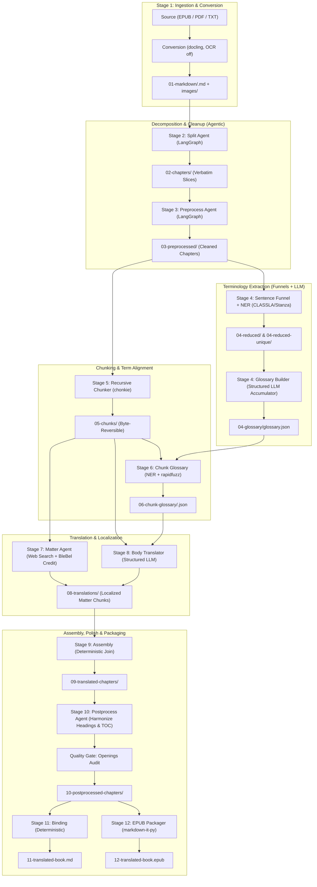
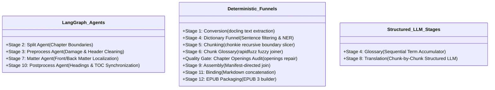

# System Architecture & Philosophy

The **BleBelTranslateBook** (`book-translator`) repository provides an industrial-grade translation pipeline that turns long, complex books (EPUB, text-based PDF, or Markdown) into publisher-quality translated EPUB 3 books and Markdown editions.

Rather than feeding entire manuscripts into monolithic LLM prompts or relying on unstructured chat completions, `book-translator` implements a **staged, verifiable agentic pipeline** combining **specialized LangGraph state machine agents** with **rigorous deterministic funnels**.

---

## 1. High-Level Architecture Diagram

---

## 2. Core Architectural Principles

### Invariant 1: Structural Agents Never Read Body Prose
LLMs tend to hallucinate, omit text, rephrase lines, or drift when exposed to massive walls of prose. In `book-translator`, agents in structural stages (Stage 1 Split, Stage 2 Preprocess, Stage 9 Postprocess) **never read the body prose**:
* **Stage 1 (Split):** The agent only inspects line numbers and short candidate headings emitted by deterministic tools. The actual slicing is done byte-for-byte by the slicer.
* **Stage 2 (Preprocess):** The agent only inspects headers, page-number candidates, and conversion damage. It outputs a declarative cleaning plan.
* **Stage 9 (Postprocess):** The agent only inspects the first dozen lines of each chapter and heading records to establish a book-wide title hierarchy.

### Invariant 2: Plan-Action Separation with Deterministic Verifiers
No agent directly writes or edits files. All agents operate through strict plan-action separation:
1. The agent examines bounded tool outputs (maximum character caps enforced).
2. The agent calls a proposal tool (`report_split_proposal`, `report_chapter_cleaning`, `report_matter_plan`, `report_chapter_postprocess`).
3. A **deterministic validator** checks the proposal against the real source document (e.g. verifying that split line numbers exist and form contiguous non-overlapping spans, or verifying that lines marked for removal are strictly page-number artifacts).
4. If validation fails, feedback is delivered back to the agent in the LangGraph state loop.
5. Only when validation succeeds does the graph's execution node write output to disk.

### Invariant 3: Byte-For-Byte Reversibility
Decomposition must be provably lossless:
* **Stage 2 (Split):** Concatenating all chapter files in `02-chapters/` recreates the source Markdown document byte-for-byte (verified via SHA-256 in `_split_manifest.json`).
* **Stage 5 (Chunking):** Chunks in `05-chunks/` are exact slices. Concatenating a chapter's chunks restores the preprocessed chapter byte-for-byte. Concatenating all chunks in global reading order restores the book.

### Invariant 4: Strict Per-Line and Per-Chunk Provenance
Every transformation records exhaustive provenance:
* **Stage 3:** Writes `_preprocess_manifest.json` with a per-line provenance map proving that every line in `03-preprocessed/` either matches the original line or was altered by a validated operation (`keep`, `promote`, `demote`, `remove`, `merge_with_next`).
* **Stage 8:** Writes `08-translation-prompts/` recording the exact system prompt, user prompt, glossary rows, source text, and raw model response for every single chunk, ensuring translation issues are 100% debuggable.

---

## 3. The 4 LangGraph Agents vs. Deterministic Funnels

The pipeline cleanly separates tasks requiring fuzzy reasoning from tasks requiring deterministic guarantees:

* **LangGraph Agents:** Used when heuristics alone are insufficient to resolve ambiguous semantic layout (e.g., distinguishing a printed book title at the top of a page from an internal section header, or synthesizing publisher-grade front matter).
* **Deterministic Funnels:** Used wherever mathematical or string-exact precision is required. Chunker, fuzzy dictionary matcher, chunk assembler, and EPUB compiler never invoke an LLM.
* **Structured LLM Stages:** Single-purpose, schema-enforced Pydantic invocation loops (`StructuredCaller` in [book_translator/core/llm.py](file:///home/jovis/Documents/WORK/BleBelTranslateBook/book_translator/core/llm.py)) with automatic retries and JSON-mode fallback.

---

## 4. Multi-Provider AI Architecture

`book-translator` connects to multiple AI backends via an OpenAI-compatible interface, configured through [book_translator.toml](file:///home/jovis/Documents/WORK/BleBelTranslateBook/book_translator.toml):

1. **DeepSeek (Cloud Default):** Fast, economical, high-quality reasoning (`deepseek-flash`, `deepseek-v4-pro`).
2. **LM Studio (Local / Completely Offline):** Local OpenAI-compatible server at `http://127.0.0.1:1234/v1`. Auto-detects whatever model is loaded; no model name required.
3. **OpenAI:** `gpt-4.1-mini`, `gpt-4o`, `o3-mini`.
4. **Google Gemini:** Direct endpoint (`gemini-3.8-flash`, `gemini-3.1-flash-image` for multimodal matter image recreation). Set `GEMINI_API_KEY` in `.env`.

Every stage can use a different provider or model (e.g., DeepSeek for splitting, local LM Studio for translation, Claude for front-matter synthesis, Gemini for multimodal matter image recreation).

> [!NOTE]
> **Multimodal Matter Translation (Stage 7):** While stages 1-6 and 8-10 use text models, Stage 7 performs both front/back matter text localization and end-to-end **multimodal image translation** (recreating covers and title plates from scratch with translated lettering). A multimodal model with vision input and image synthesis capabilities (such as `gemini-3.1-flash-image`) is required for this step.

---

## 5. Execution Model and Orchestration

The pipeline is driven by [book_translator/pipeline/driver.py](file:///home/jovis/Documents/WORK/BleBelTranslateBook/book_translator/pipeline/driver.py):
* **State Resolution:** Each stage reads the output of its predecessor from canonical numbered folders (`01-markdown/` through `10-postprocessed-chapters/`).
* **Resumability & Cache Invalidation:** Stages support `--skip-if-present` (or `--resume`). If chapter, chunk, or translation files already exist and match their expected hashes, expensive LLM calls are skipped.
* **Partial Execution:** Operators can run windowed runs (e.g. `--first-chapters 5`), stop after specific stages (`--stop-after chunk`), or restart at downstream stages (`--start-at translate`).
