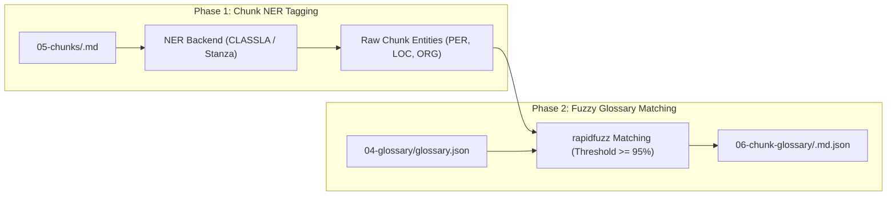

# Pipeline Stages 1 to 6: Ingestion, Decomposition, Terminology & Chunking

This document provides complete, systematic specifications for the first six stages of the pipeline: from converting the raw source document up to matching per-chunk glossary terms.

---

## Stage 1: Conversion (`book_translator.stages.conversion`)

> **Question Answered:** *What does this source document say as plain Markdown, and where are its pictures?*

### Purpose & Invariants
* Accepts `.epub`, `.pdf`, `.txt`, and `.md` formats.
* If the source is already Markdown (`.md` or `.markdown`), Stage 1 is a no-op; Stage 2 reads the file directly.
* Plain text (`.txt`) is copied byte-for-byte under a `.md` filename.
* EPUB and PDF files are converted using **Docling**.
* **Strict OCR Refusal Policy:** For PDF files, embedded text layers are checked before conversion. Scanned or image-only PDFs without a real text layer are rejected immediately with an actionable error. The pipeline will not guess or invent text via OCR.
* **Image Extraction:** Embedded images are extracted to `01-markdown/images/` and referenced in Markdown using standard image tags (``). Use `--no-images` to disable picture extraction.

### Artifacts Written
* `data/output/<book>/01-markdown/<book>.md`
* `data/output/<book>/01-markdown/images/*` (illustrations, maps, photos)
* `data/output/<book>/01-markdown/_convert_manifest.json` (records source file SHA-256 and conversion settings)

---

## Stage 2: Chapter Split (`book_translator.stages.agent` & `slicing`)

> **Question Answered:** *Where does each chapter start, without reading the body prose?*

### Purpose & Invariants
* Analyzes the source Markdown structure using the **Split Agent** (LangGraph).
* Operates strictly on line numbers, headers, and pattern matches. The agent never reads prose paragraphs.
* Slices the source file **verbatim**. No lines are reflowed, re-indented, or re-encoded.
* **Lossless Concatenation Guarantee:** Concatenating all files in `02-chapters/` in natural numerical order reproduces the source Markdown file byte-for-byte.

### Chapter Classification
Each slice is categorized into one of three kinds:
1. `front_matter`: Title page, copyright page, dedication, preface, foreword (`00-front-matter.md`).
2. `body`: Numbered or titled main book chapters (`01-chapter-1.md`, `02-chapter-2.md`, ...).
3. `back_matter`: Epilogue, afterword, acknowledgments, index, notes (`99-back-matter.md`).

### Artifacts Written
* `data/output/<book>/02-chapters/00-front-matter.md`
* `data/output/<book>/02-chapters/01-*.md`, `02-*.md`, ...
* `data/output/<book>/02-chapters/99-back-matter.md`
* `data/output/<book>/02-chapters/_manifest.json`
* `data/output/<book>/02-chapters/_agent_trace.json`

---

## Stage 3: Preprocess (`book_translator.stages.preprocess_agent`)

> **Question Answered:** *What in this chapter is layout damage, page numbers, or misplaced headers?*

### Purpose & Invariants
* Cleans conversion defects chapter by chapter using the **Preprocess Agent**.
* Detects running headers, running footers, printed page numbers embedded in text, and headings broken across lines.
* Evaluates proposed changes against a strict 5-action vocabulary (`keep`, `promote`, `demote`, `remove`, `merge_with_next`).
* Operates as a pure function of `(chapter_path, output_dir)` to guarantee deterministic, isolated results.
* Runs the deterministic **Chapter Openings Audit** at completion to clean any lingering stray numbers before prose begins.

### Provenance Tracking
Generates a complete per-line provenance record:
```json
{
  "source_line": 142,
  "output_line": 139,
  "operation": "remove",
  "reason": "isolated printed page number '42'"
}
```

### Artifacts Written
* `data/output/<book>/03-preprocessed/00-front-matter.md`
* `data/output/<book>/03-preprocessed/01-*.md`, ...
* `data/output/<book>/03-preprocessed/_preprocess_manifest.json`
* `data/output/<book>/03-preprocessed/_preprocess_trace.json`

---

## Stage 4: Entity Extraction & Glossary (`book_translator.stages.dictionary` & `glossary`)

> **Question Answered:** *Which proper nouns need consistent translation across the entire book, and how must they be rendered?*

### Purpose & Two-Phase Design
Stage 4 brings together entity sentence reduction (`dictionary` command) and LLM-assisted term translation (`glossary` command):

#### 1. Dictionary Funnel (`book_translator.stages.dictionary`)
* A **deterministic sentence extractor** combined with a high-speed Named Entity Recognition (NER) tagger.
* **No LLM is called in this step.** It operates purely on CPU/GPU language models:
  * South Slavic / Balkan languages: **CLASSLA** pipeline.
  * English and other Western languages: **Stanza** pipeline.
* Sentence Funnel rules:
  1. Splits chapter prose into individual sentences.
  2. Discards sentences shorter than `DEFAULT_MIN_SENTENCE_WORDS` (default: 4 words).
  3. Tags Named Entities (`PER` for Person, `LOC` for Location, `ORG` for Organization).
  4. Keeps only sentences that carry genuine named entities.
* Generates two outputs:
  * Full reduced sentences (`04-reduced/`).
  * **First Mentions Only** (`04-reduced-unique/`): Keeps only the first occurrence of each entity across the book, dramatically reducing token costs for glossary building.

#### 2. Glossary Builder (`book_translator.stages.glossary`)
* Iterates through the first-mention sentences in `04-reduced-unique/` **in reading order**.
* Calls a structured LLM (via `StructuredCaller`) to lock in target language translations for characters, place names, organizations, and recurring terms of art.
* **Accumulator Memory Architecture:**
  * When translating Chapter 1 entities, the glossary is empty.
  * When translating Chapter 2 entities, the prompt includes all terms locked in Chapter 1.
  * By Chapter 40, the model receives the complete book-wide glossary so far, preventing conflicting translations of recurring terms.
* **Front & Back Matter Skipped by Default:** Prevents locking original edition publisher names, copyright dates, or translator names into the translation glossary.

### Pydantic Output Schema
```json
{
  "terms": [
    {
      "source": "Hercule Poirot",
      "target": "Erkil Poaro",
      "category": "character",
      "notes": "Belgian detective, phonetic Serbian Cyrillic/Latin"
    }
  ]
}
```

### Artifacts Written
* `data/output/<book>/04-reduced/*.md`
* `data/output/<book>/04-reduced-unique/*.md`
* `data/output/<book>/04-reduced/_reduced_manifest.json`
* `data/output/<book>/04-glossary/glossary.json` (Machine-readable term dictionary)
* `data/output/<book>/04-glossary/glossary.md` (Human-readable markdown table)
* `data/output/<book>/04-glossary/_glossary_manifest.json`

---

## Stage 5: Reversible Chunking (`book_translator.stages.chunking`)

> **Question Answered:** *Where can the chapter be cut into translation-sized chunks without breaking sentences or paragraphs?*

### Purpose & Invariants
* Cuts each preprocessed chapter into translation chunks (default target: ~1000 tokens) using `chonkie`'s recursive chunker.
* Respects natural textual boundaries in strict priority order:
  1. Markdown paragraph breaks (`\n\n`)
  2. Sentence terminators (`. `, `! `, `? `)
  3. Soft line breaks (`\n`)
  4. Word spaces
* **Zero Text Loss / Absolute Invariant:** Concatenating a chapter's chunks restores the original chapter file byte-for-byte:
  $$\bigoplus_{k=0}^{M} \text{chunk}_k \equiv \text{chapter}$$
* Chunks are numbered globally (`00001-...`, `00002-...`) so directory sorting reflects the exact reading order of the entire book.

### Artifacts Written
* `data/output/<book>/05-chunks/00000-00-front-matter-0000.md`
* `data/output/<book>/05-chunks/00001-01-chapter-1-0000.md`
* `data/output/<book>/05-chunks/00002-01-chapter-1-0001.md`
* `data/output/<book>/05-chunks/_chunk_manifest.json`
* `data/output/<book>/05-chunks/_chunk_trace.json`

---

## Stage 6: Chunk Glossary (`book_translator.stages.chunk_glossary`)

> **Question Answered:** *Which locked glossary terms does this specific chunk actually mention?*

### Purpose & Two-Phase Design
Sending a 500-term book glossary to an LLM for every single 1000-token chunk would waste tokens and distract the model with irrelevant names. Stage 6 attaches *only* the terms relevant to each chunk.

The stage runs in two strict sequential phases with **zero LLM calls**:



1. **Phase 1 (Chunk NER):** The NER tagger processes all chunks across the book to discover every candidate proper noun in its local context.
2. **Phase 2 (Fuzzy Retrieval):** For each discovered term, `rapidfuzz` matches against `04-glossary/glossary.json`. Any match exceeding the similarity threshold (default: 95%) is added to the chunk's `matched_terms` list.

### Artifacts Written
* `data/output/<book>/06-chunk-glossary/<chunk>.md.json` (One JSON file per chunk)
* `data/output/<book>/06-chunk-glossary/_chunk_glossary_manifest.json`
