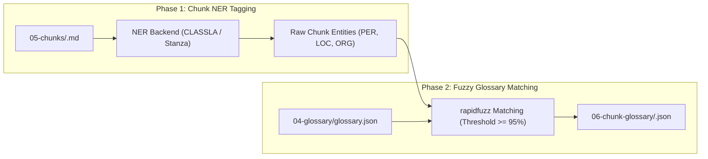

# Pipeline Stages 6 to 11: Alignment, Translation, Postprocessing & EPUB

This document details the second half of the pipeline: attaching localized terms to chunks, localizing front/back matter, translating body chunks, reassembling chapters, harmonizing headings, and compiling the finished EPUB 3 book.

---

## Stage 6: Chunk Glossary (`book_translator.stages.chunk_glossary`)

> **Question Answered:** *Which locked glossary terms does this specific chunk actually mention?*

### Purpose & Two-Phase Design
Sending a 500-term book glossary to an LLM for every single 1000-token chunk would waste tokens and distract the model with irrelevant names. Stage 6 attaches *only* the terms relevant to each chunk.

The stage runs in two strict sequential phases with **zero LLM calls**:

1. **Phase 1 (Chunk NER):** The NER tagger processes all chunks across the book to discover every candidate proper noun in its local context.
2. **Phase 2 (Fuzzy Retrieval):** For each discovered term, `rapidfuzz` matches against `04-glossary/glossary.json`. Any match exceeding the similarity threshold (default: 95%) is added to the chunk's `matched_terms` list.

### Artifacts Written
* `data/output/<book>/06-chunk-glossary/<chunk>.json` (One JSON file per chunk)
* `data/output/<book>/06-chunk-glossary/_chunk_glossary_manifest.json`

---

## Stage 6b: Matter Localization Agent (`book_translator.stages.matter_agent`)

> **Question Answered:** *How is front and back matter localized, credited to BleBel, and pruned of obsolete publisher info?*

### Purpose & Invariants
* Runs **before body translation**.
* **Uses No Dictionary:** Front matter (title pages, copyright blocks) and back matter (acknowledgments, author notes) carry imprint and licensing text that should not follow standard novel entity dictionaries.
* **Web Search for Official Title:** Searches DuckDuckGo for previously published translations in the target language (e.g. Serbian, Croatian) to maintain canonical book titles.
* **Translator Credit Policy:** Embeds publisher credit to **BleBel** (`Prevod: BleBel`).
* **Cover First:** A cover picture in the first front-matter chunk stays the first block of the book; the localized title and credit follow it, never precede it.
* **Pruning Policy:** Identifies and strips original foreign edition ISBNs, Library of Congress CIP entries, barcode notices, and foreign publisher addresses.
* **Direct Integration:** Writes translated matter chunks directly into `07-translations/`, allowing Stage 7 to skip matter and Stage 8 to assemble the book without custom joining logic.

### Multimodal Matter Image Translation & Recreation
Front and back matter frequently feature images containing source-language typography: book covers, illustrated title plates, frontispieces, calligraphic headers, or publisher insignia. Stage 6b includes end-to-end multimodal image translation to localize these assets:

1. **Matter Image Discovery:** After localizing the Markdown text of a front or back matter chunk, the stage scans for Markdown (``) or HTML (``) image references.
2. **Context-Enriched Multimodal Prompting:** Each referenced image is paired with rich contextual metadata—the localized book title, author, translator credit (`Prevod: BleBel`), and surrounding matter Markdown text—and submitted to a multimodal model.
3. **Text Detection vs. Pure Artwork:**
   * If the image is purely decorative or an author portrait with no translatable text, the model returns `{"recreated": false, "has_text": false}`. The original image remains completely intact.
   * If source text is detected (e.g. the original title and author on the cover), the multimodal model regenerates the entire image end-to-end.
4. **End-to-End Image Synthesis (No Bounding Boxes):** The model recreates the whole illustration from scratch with translated typography seamlessly blended into the artwork, lighting, and composition. Patchwork overlays, PIL rectangles, and bounding-box erasures are strictly avoided.
5. **Path Rewriting & Preservation:** The generated image is saved to `data/output/<book>/07-translations/images/<stem>_translated.<ext>` (and mirrored to `00-markdown/images/`). The Markdown chunk is automatically updated to reference the translated image.
6. **Model Requirement:**
   > [!IMPORTANT]
   > **Multimodal Model Required:** An image-capable multimodal model (such as `gemini-3.1-flash-image` via Google Gemini) is **required** for this step. Ensure `GEMINI_API_KEY` is configured in your `.env` file or specify a multimodal model under `[llm.matter]` in `book_translator.toml`. If a text-only model is used for text matter translation, the pipeline automatically spins up the multimodal image model when `GEMINI_API_KEY` is present.

### Artifacts Written
* `data/output/<book>/07-translations/00000-00-front-matter-*.md`
* `data/output/<book>/07-translations/images/*_translated.*` (Recreated matter images)
* `data/output/<book>/06b-matter/matter_plan.json`
* `data/output/<book>/06b-matter/_matter_manifest.json` (Includes per-chunk `images` metadata)
* `data/output/<book>/06b-matter/_matter_trace.json` (Includes per-chunk `images` transformation logs)
* `data/output/<book>/06b-matter-prompts/*` (Complete agent prompt logs for review)

---

## Stage 7: Body Translation (`book_translator.stages.translation`)

> **Question Answered:** *What does this body chunk say in the target language, following the locked glossary terms?*

### Purpose & Invariants
* Translates body chunks sequentially in reading order.
* **Prompt Assembly:**
  1. System prompt enforcing tone, style, and Markdown preservation rules.
  2. Targeted glossary terms from Stage 6 (`matched_terms`).
  3. Preceding translation context (sliding tail of previous chunk) to preserve sentence flow and pronoun continuity.
  4. The source chunk text.
* **Schema Validation & Self-Healing:** The model is queried using `StructuredCaller` for `{"translation": "..."}`. If the model outputs an apology, an unescaped markdown fence, or identical untranslated text, it is retried with the exact error named.
* **Full Auditability:** Every call logs its full context into `07-translation-prompts/` (both as JSON and as human-readable `.prompt.md`).

### Provider Options
* **DeepSeek (Cloud):** Fast, high-capacity, cost-effective cloud default.
* **LM Studio (Local):** Run 100% offline and privately on local hardware. The pipeline auto-discovers the model currently loaded in LM Studio.

### Artifacts Written
* `data/output/<book>/07-translations/<chunk>.md`
* `data/output/<book>/07-translation-prompts/<chunk>.json`
* `data/output/<book>/07-translation-prompts/<chunk>.prompt.md`
* `data/output/<book>/07-translations/_translation_manifest.json`

---

## Stage 8: Chapter Assembly (`book_translator.stages.assembly`)

> **Question Answered:** *What does each whole chapter say, now that all its chunks are translated?*

### Purpose & Invariants
* Reassembles translated chunks into full chapter Markdown files in `08-translated-chapters/`.
* **Group by Manifest, Not Filename Guesses:** Reads `_chunk_manifest.json` to verify chapter membership and chunk ordering.
* **No Incomplete Chapters:** If a partial translation was run (e.g. `--limit 10`), incomplete chapters are reported and omitted rather than written as truncated files.
* **Separate Output Folder:** Does not touch or overwrite source chapters in `01-chapters/`.

### Artifacts Written
* `data/output/<book>/08-translated-chapters/00-front-matter.md`
* `data/output/<book>/08-translated-chapters/01-*.md`, `02-*.md`, ...
* `data/output/<book>/08-translated-chapters/_assembly_manifest.json`

---

## Stage 9: Postprocess Agent (`book_translator.stages.postprocess_agent`)

> **Question Answered:** *Are translated chapter titles, section headings, and the table of contents consistent?*

### Purpose & Invariants
* Standardizes headings across all translated chapters.
* Establishes a uniform book-wide heading convention (e.g. `# Glava 1: [Naslov]`).
* Reconciles the generated navigation Table of Contents with the translated chapter headings.
* Never edits body prose. Inspects only heading records and the first 12 lines of each chapter.

### Quality Gate: Chapter Openings Audit (`book_translator.stages.openings`)
At the end of Stage 9, the automated openings audit scans the first lines of every chapter:
* **Duplicate Titles:** Removes cases where the title appears twice (e.g. `# Poglavlje 1` followed immediately by `Poglavlje 1`).
* **Stray Numbers:** Deletes residual printed page numbers preceding or following the chapter heading.
* **Opening Sanity:** Verifies that every chapter starts with an appropriate `#` heading rather than a broken paragraph.

### Artifacts Written
* `data/output/<book>/09-postprocessed-chapters/*.md`
* `data/output/<book>/09-postprocessed-chapters/_postprocess_manifest.json`
* `data/output/<book>/09-postprocessed-chapters/_postprocess_trace.json`

---

## Stage 10: Final Markdown Binding (`book_translator.stages.binding`)

> **Question Answered:** *What does the entire translated book look like as a single Markdown document?*

### Purpose & Invariants
* Deterministically concatenates all files in `09-postprocessed-chapters/` in natural numerical order.
* Separates chapters with a single blank line.
* Rewrites relative image links (`images/...`) so they resolve from the book root folder.
* Verifies file integrity by re-reading and calculating the final SHA-256 hash.

### Artifacts Written
* `data/output/<book>/10-translated-book.md`
* `data/output/<book>/_bind_manifest.json`

---

## Stage 11: EPUB 3 Packaging (`book_translator.stages.epub`)

> **Question Answered:** *What does the book look like in an e-reader device or mobile app?*

### Purpose & Invariants
* Compiles `09-postprocessed-chapters/` into a fully standards-compliant **EPUB 3** publication: `11-translated-book.epub`.
* Reads chapters directly from the folder (not from the bound Markdown file), ensuring each chapter forms a distinct spine item that starts on a fresh page in e-readers.
* **Markdown-to-XHTML:** Converted using `markdown-it-py` with clean typographical formatting.
* **Navigation Document:** Automatically generates an EPUB 3 `nav.xhtml` Table of Contents from chapter headings.
* **Image Embedding:** Copies illustrations from `00-markdown/images/` directly into the EPUB container under `OEBPS/images/`, updating image references.
* **Embedded Stylesheet:** Injects typography and layout styles from [style.css](file:///home/jovis/Documents/WORK/BleBelTranslateBook/book_translator/stages/epub/assets/style.css).
* **Deterministic Packaging:** Pins archive entry timestamps to the latest chapter modification time, guaranteeing bit-for-bit reproducible EPUB builds.

### Artifacts Written
* `data/output/<book>/11-translated-book.epub` (The ready-to-read book)
* `data/output/<book>/_epub_manifest.json`
